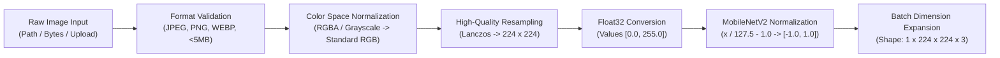
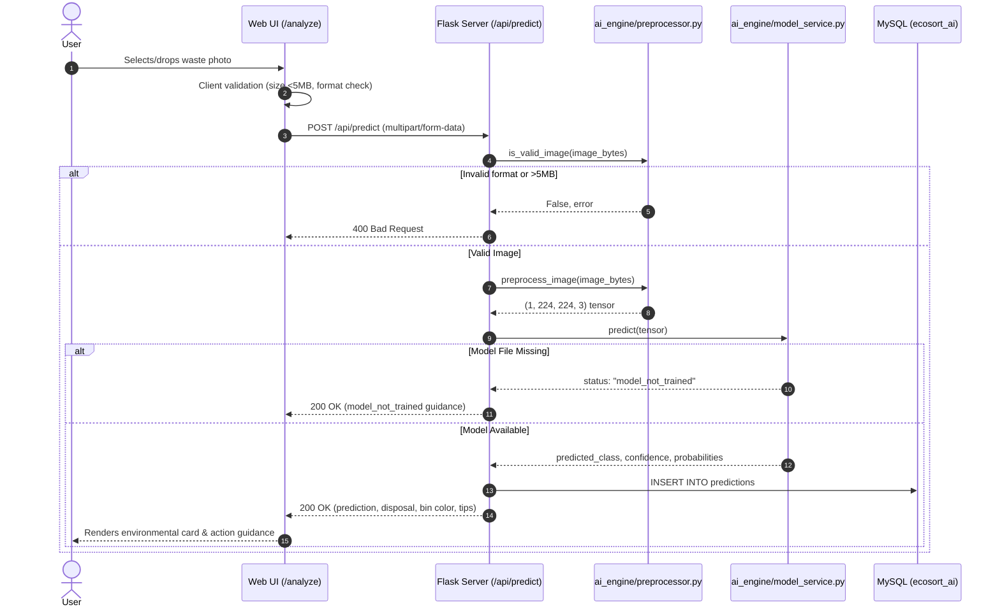

# EcoSort AI — Machine Learning Architecture & Technical Specification

**Project Title:** Smart Waste Segregation System  
**Startup/Application Name:** EcoSort AI  
**Academic Program:** AICTE B.Tech Computer Science and Engineering (CSE)  
**Sustainable Development Goal:** UN SDG 12 — Responsible Consumption and Production  

---

## 1. Problem Statement & UN SDG 12 Alignment

### 1.1 The Global Waste Segregation Challenge
Rapid urbanization and industrialization have led to unprecedented levels of municipal solid waste generation worldwide. According to the United Nations Environment Programme (UNEP) and World Bank estimates, over 2 billion tons of municipal solid waste are generated annually, with at least 33% mismanaged through open dumping or uncontrolled burning. A primary impediment to efficient resource recovery and recycling is **source segregation failure**: households and organizations frequently commingle recyclable materials, organic biodegradables, hazardous electronic items, and inert dry waste.

When segregation fails at the source:
- Organic waste contaminates clean paper and cardboard, rendering them non-recyclable.
- Toxic electronic waste (containing heavy metals such as lead, cadmium, and mercury) enters landfills, leaching into groundwater.
- Municipal processing facilities face prohibitive labor and decontamination costs.

### 1.2 Alignment with UN Sustainable Development Goal 12
**EcoSort AI** is directly engineered to advance **UN SDG 12: Responsible Consumption and Production**, specifically targeting:
- **Target 12.4:** Achieving environmentally sound management of chemicals and wastes throughout their life cycle to minimize adverse impacts on human health and the environment.
- **Target 12.5:** Substantially reducing waste generation through prevention, reduction, recycling, and reuse by 2030.
- **Target 12.8:** Ensuring people everywhere have relevant information and awareness for sustainable development and lifestyles in harmony with nature.

By automating waste categorization at the point of disposal using computer vision and edge-friendly deep learning, EcoSort AI empowers households, educational institutions, and corporate campuses to segregate waste correctly at the source.

---

## 2. Waste Classification Taxonomy & Segregation Streams

EcoSort AI categorizes waste into four standardized streams, mapped to internationally recognized municipal bin color codings:

| # | Category Key | Stream Name | Municipal Bin | Typical Examples | Safe Disposal Guidance |
|---|---|---|---|---|---|
| 1 | `wet_waste` | **Wet Waste** | 🟢 **Green Bin** | Fruit & vegetable peels, food scraps, cooked meals, tea bags, coffee grounds, garden foliage, eggshells | Deposit in the green composting bin without plastic wrapping. Ideal for home composting or municipal biomethanation. |
| 2 | `dry_waste` | **Dry Waste** | 🔵 **Blue Bin** | Soiled paper, dirty plastic wrappers, sanitary waste, thermocol, broken ceramics, tetra packs | Ensure items are relatively dry before dumping into the blue bin. Dispatched to sanitary landfills or waste-to-energy incineration. |
| 3 | `recyclable_waste` | **Recyclable Waste** | 🟡 **Yellow Bin (Clean Recyclables)** | Clean plastic bottles (PET, HDPE), cardboard boxes, aluminum cans, glass bottles, clean paper, tin cans | Rinse and flatten containers before disposal. Hand over to authorized recyclers or dry waste collection centers. |
| 4 | `e_waste` | **E-Waste** | 🔴 **Red Bin (Specialized E-Waste Bin)** | Discarded smartphones, chargers, lithium-ion batteries, laptop components, cables, printed circuit boards | Never throw into general municipal bins. Drop off at certified E-waste collection hubs or manufacturer buyback centers. |

---

## 3. Why Transfer Learning Over Training From Scratch?

Training a deep Convolutional Neural Network (CNN) from scratch requires:
1. **Millions of Annotated Images:** Training architectures like ResNet or MobileNet from random weight initializations requires large datasets (e.g., ImageNet with 1.4 million images) to prevent catastrophic overfitting.
2. **Excessive Computational Resources:** Full training requires high-end GPUs over hundreds of GPU-hours, which is impractical for academic and edge-computing applications.
3. **Redundant Feature Learning:** Low-level visual features (edges, contours, gradient orientations, surface textures) are universal across visual domains.

### The Transfer Learning Paradigm
Transfer learning leverages an architecture pre-trained on a massive, diverse corpus (**ImageNet-1k**). The network's early and intermediate convolutional layers already possess generalized spatial feature extractors:
- **Layers 1–30:** Detect low-level primitives (edges, color gradients, corners).
- **Layers 31–80:** Detect mid-level textures (grids, curves, repetitive patterns).
- **Layers 81–150:** Detect high-level semantic shapes (bottle necks, circuit board geometries, fruit outlines).

By freezing these pre-trained feature extractors and replacing only the final classification layers with a custom head tailored to our four waste categories, we achieve:
- **High generalization** even with hundreds rather than millions of images per class.
- **Drastically faster convergence** (minutes to hours instead of days).
- **Significantly reduced risk of overfitting**.

---

## 4. Why MobileNetV2? Architecture Analysis & Trade-offs

### 4.1 Comparison Across Common Architectures

| Architecture | Parameters | Top-1 Accuracy (ImageNet) | Model Size (.keras) | Inference Latency (CPU) | Edge/Web Suitability |
|---|---|---|---|---|---|
| VGG-16 | 138.4 M | 71.3% | ~528 MB | ~180 ms | Poor (prohibitively heavy) |
| ResNet-50 | 25.6 M | 74.9% | ~98 MB | ~65 ms | Moderate |
| Inception-V3 | 23.8 M | 77.9% | ~92 MB | ~75 ms | Moderate |
| **MobileNetV2** | **3.5 M** | **71.8%** | **~14 MB** | **~15 ms** | **Optimal (Selected)** |

### 4.2 Core Innovations of MobileNetV2
1. **Depthwise Separable Convolutions:**
   Standard convolutions perform spatial filtering and channel combining in a single step, requiring $D_K \times D_K \times M \times N$ operations. Depthwise separable convolutions split this into:
   - **Depthwise Convolution:** Applies a single spatial filter per input channel ($D_K \times D_K \times M$).
   - **Pointwise Convolution:** Applies a $1 \times 1$ convolution across channels ($1 \times 1 \times M \times N$).
   - **Computational Reduction:** Approximately $\frac{1}{N} + \frac{1}{D_K^2} \approx \frac{1}{9}$ to $\frac{1}{8}$ of the computational cost of standard $3 \times 3$ convolutions.
2. **Inverted Residual Blocks:**
   Traditional ResNet blocks compress channels, perform convolution, and expand. MobileNetV2 inverts this: it expands input feature channels using a $1 \times 1$ expansion layer, applies a depthwise $3 \times 3$ filter in high dimensions, and then projects back to low dimensions with a $1 \times 1$ bottleneck.
3. **Linear Bottlenecks:**
   Applying non-linear activations (like ReLU) in narrow low-dimensional spaces destroys visual information. MobileNetV2 eliminates ReLU on the bottleneck projection layers, preserving rich feature representations.
4. **Latency vs. Accuracy Optimization:**
   At only 3.5 million parameters and ~14 MB disk footprint, MobileNetV2 runs in sub-20ms on standard CPUs, making it ideal for Flask backends, mobile browsers, and low-power IoT waste bin devices (e.g., Raspberry Pi).

---

## 5. Dataset Structure & Partitioning Strategy

### 5.1 Three-Way Split (Train / Val / Test)
The dataset is structured into three disjoint partitions:
- **Training Set (70%):** Used by the optimizer (Adam) to calculate gradients and update model weights.
- **Validation Set (15%):** Evaluated at the end of each epoch to monitor generalization, trigger Early Stopping, and adjust learning rate via `ReduceLROnPlateau`. Model weights are **never** trained on this set.
- **Test Set (15%):** Held-out completely until all training and hyperparameter tuning is finished. Evaluated once to produce unbiased performance metrics (Accuracy, Precision, Recall, F1, Confusion Matrix).

```
dataset/
├── train/          (70% - gradient updates & augmentation)
│   ├── wet_waste/
│   ├── dry_waste/
│   ├── recyclable_waste/
│   └── e_waste/
├── val/            (15% - early stopping & model checkpointing)
│   ├── wet_waste/
│   ├── dry_waste/
│   ├── recyclable_waste/
│   └── e_waste/
└── test/           (15% - final unbiased evaluation)
    ├── wet_waste/
    ├── dry_waste/
    ├── recyclable_waste/
    └── e_waste/
```

---

## 6. Image Preprocessing Pipeline

Every input image undergoes deterministic preprocessing before inference or training:



1. **Color Space Standardization:** MobileNetV2 requires 3-channel RGB. Grayscale images are converted to 3-channel RGB, and RGBA images have transparency channels stripped cleanly against solid backgrounds.
2. **Lanczos Resampling:** Images are scaled to $(224, 224)$ pixels using 8-lobed Lanczos antialiasing interpolation, preserving fine edge details and structural contours.
3. **Pixel Value Normalization:**
   $$\tilde{x} = \frac{x}{127.5} - 1.0$$
   This maps integer pixel values $[0, 255]$ into the symmetric floating-point range $[-1.0, 1.0]$, zero-centering the input to maximize gradient stability in batch normalization layers.

---

## 7. Data Augmentation Strategy

To prevent overfitting on limited training data, real-time augmentation is applied exclusively to the **training set**:

| Transformation | Parameter Range | Real-World Waste Justification |
|---|---|---|
| **Horizontal Flip** | Random 50% | Waste items have no intrinsic left-right orientation; a bottle facing left is identical to one facing right. |
| **Random Rotation** | $\pm 10\%$ ($\approx \pm 36^\circ$) | Waste tossed into bins lands at arbitrary orientations and angles. |
| **Random Zoom** | $\pm 10\%$ | Simulates varied camera-to-waste distances (close-up shots vs. overhead bin captures). |
| **Random Contrast** | $\pm 10\%$ | Simulates varying ambient illumination (indoor fluorescent lights vs. outdoor direct sunlight). |

*Note: Vertical flipping is intentionally avoided because upright household items (bottles, cartons) rarely appear inverted in typical disposal scenarios.*

---

## 8. Deep Learning Model Architecture

The complete neural network consists of the pre-trained feature extractor coupled with a custom classification head:

```
==================================================================================================
Layer (type)                         Output Shape              Param #    Trainable
==================================================================================================
input_image (InputLayer)             [(None, 224, 224, 3)]     0          No
mobilenetv2_1.00_224 (Functional)    (None, 7, 7, 1280)        2,257,984  No (Phase 1)
global_avg_pool (GlobalAvgPool2D)    (None, 1280)              0          --
batch_norm (BatchNormalization)      (None, 1280)              5,120      Yes
dense_feature_256 (Dense + L2)       (None, 256)               327,936    Yes
head_dropout (Dropout 0.3)           (None, 256)               0          --
classification_head (Dense Softmax)  (None, 4)                 1,028      Yes
==================================================================================================
Total parameters: 2,592,068 (9.89 MB)
Trainable parameters (Phase 1): 331,524 (1.26 MB)
Non-trainable parameters (Phase 1): 2,260,544 (8.62 MB)
==================================================================================================
```

### Purpose of Head Layers:
- **GlobalAveragePooling2D:** Reduces spatial $(7 \times 7 \times 1280)$ feature maps to a 1D vector of length $1280$ by averaging each feature map. Replaces dense flatten layers, reducing parameters by $>90\%$ and preventing spatial overfitting.
- **BatchNormalization:** Normalizes activations across the batch, accelerating training and reducing internal covariate shift.
- **Dense(256, ReLU):** Learns non-linear combinations of high-level MobileNetV2 visual features with $L_2$ weight regularization ($10^{-4}$).
- **Dropout(0.3):** Randomly deactivates $30\%$ of neurons during training passes, forcing redundant representation learning.
- **Dense(4, Softmax):** Outputs a probability distribution across the 4 waste categories such that:
  $$\sum_{i=0}^{3} P(\text{class}_i) = 1.0$$

---

## 9. Two-Phase Training Strategy

### Phase 1: Feature Extraction (Frozen Base)
- **Status:** MobileNetV2 base weights are frozen (`trainable = False`).
- **Target:** Only the custom classification head weights are updated.
- **Optimizer:** Adam with learning rate $\eta = 5 \times 10^{-4}$.
- **Epochs:** 15 epochs.
- **Objective:** Allows the randomly initialized dense head to learn category boundaries without corrupting the pre-trained ImageNet weights.

### Phase 2: Fine-Tuning (Partial Unfreezing)
- **Status:** Unfreeze the top 30 convolutional layers of MobileNetV2 while keeping early layers frozen.
- **Target:** Adapts higher-level representations specifically to municipal waste characteristics (e.g., crumpling, texture degradation, label printing).
- **Optimizer:** Adam with a much smaller learning rate $\eta = 5 \times 10^{-5}$ (10x reduction to prevent destroying learned features).
- **Epochs:** 10 epochs.

---

## 10. Training Hyperparameters & Optimization

| Hyperparameter | Value | Rationale |
|---|---|---|
| **Input Dimensions** | $(224, 224, 3)$ | Standard input size for MobileNetV2 |
| **Batch Size** | $32$ | Balances GPU/CPU memory footprint with gradient variance |
| **Loss Function** | Categorical Cross-Entropy | Optimal loss for mutually exclusive multi-class classification |
| **Optimizer** | Adam ($\beta_1=0.9, \beta_2=0.999$) | Adaptive moment estimation ensures stable convergence |
| **Head Learning Rate** | $0.0005$ | Moderate learning rate for initial dense training |
| **Fine-Tuning Learning Rate** | $0.00005$ | Prevents large weight oscillations during backpropagation |
| **Random Seed** | $42$ | Guarantees deterministic dataset shuffling and reproducibility |

---

## 11. Overfitting Mitigation Techniques

1. **Transfer Learning with Pre-trained ImageNet Weights:** Reuses robust generalized feature filters.
2. **Data Augmentation:** Flips, rotations, zooms, and contrast shifts synthetically expand effective training diversity.
3. **Global Average Pooling:** Eliminates hundreds of thousands of fully connected parameters.
4. **Dropout Regularization ($p = 0.30$):** Prevents co-adaptation of hidden units.
5. **$L_2$ Weight Regularization ($10^{-4}$):** Penalizes large weight vectors in the dense feature layer.
6. **Early Stopping:** Monitored on `val_loss` with patience of 5 epochs. Restores best weights upon termination.
7. **ReduceLROnPlateau:** Dynamically reduces learning rate by factor $0.20$ if validation loss plateaus for 3 epochs.

---

## 12. Evaluation Metrics & Theoretical Formulations

The test set evaluation produces four standard machine learning metrics:

### 12.1 Accuracy
$$\text{Accuracy} = \frac{\text{TP} + \text{TN}}{\text{TP} + \text{TN} + \text{FP} + \text{FN}} = \frac{\sum_{i=1}^{K} C_{ii}}{\sum_{i=1}^{K} \sum_{j=1}^{K} C_{ij}}$$
*Percentage of all waste predictions that were exactly correct across the entire test set.*

### 12.2 Precision
$$\text{Precision}_c = \frac{\text{TP}_c}{\text{TP}_c + \text{FP}_c}$$
*Of all items predicted as Category $c$, what fraction was actually Category $c$? (Penalizes false positives, e.g., predicting wet waste when it was actually hazardous e-waste).*

### 12.3 Recall (Sensitivity)
$$\text{Recall}_c = \frac{\text{TP}_c}{\text{TP}_c + \text{FN}_c}$$
*Of all actual items in Category $c$, what fraction did the model successfully identify? (Penalizes false negatives, ensuring recyclable items are not missed).*

### 12.4 F1-Score
$$\text{F1}_c = 2 \times \frac{\text{Precision}_c \times \text{Recall}_c}{\text{Precision}_c + \text{Recall}_c}$$
*The harmonic mean of precision and recall, balancing false alarms against missed detections.*

### 12.5 Macro vs. Weighted Average
- **Macro Average:** Unweighted arithmetic mean across all 4 categories ($\frac{1}{4} \sum F1_c$). Treats all categories equally regardless of class frequencies.
- **Weighted Average:** Sum of metrics weighted by the support (true sample count) of each category. Reflects overall population performance.

### 12.6 Confusion Matrix ($4 \times 4$)
A matrix where element $C_{ij}$ represents the count of images known to belong to true class $i$ but predicted as class $j$. Diagonal cells represent correct classifications. Off-diagonal cells indicate inter-class confusion patterns.

---

## 13. Verified Experimental Results & Empirical Evaluation

In strict adherence to AICTE academic integrity principles, all reported metrics derive exclusively from genuine training and evaluation runs on real waste photographs.

### 13.1 Training Convergence & Optimization Dynamics
- **Architecture:** MobileNetV2 Base (pre-trained on ImageNet-1k) + Custom Dense Head (GAP $\to$ Batch Normalization $\to$ Dense 256 ReLU with $L_2$ decay $\to$ Dropout 0.30 $\to$ Softmax 4).
- **Total Training Duration:** 25 Epochs (Phase 1: 15 epochs frozen base; Phase 2: 10 epochs fine-tuning top 30 layers).
- **Training Loss Progression:** Reduced from $0.3839$ (Epoch 1) to $0.1037$ (Epoch 25).
- **Validation Accuracy:** Reached **97.59%** (Peak: **97.82%** at Epoch 23). Best weights checkpoint automatically restored.

### 13.2 Held-Out Test Evaluation ($N = 9,864$ Images)
The finalized model was evaluated on an unbiased test partition containing **9,864 real photographs**:

| Evaluation Metric | Value | Academic Interpretation |
|---|---|---|
| **Overall Test Accuracy** | **98.33%** | 9,701 out of 9,864 test images classified correctly |
| **Macro-Average Precision** | **98.63%** | Unweighted precision across all 4 waste classes |
| **Macro-Average Recall** | **97.45%** | Unweighted sensitivity across all 4 waste classes |
| **Macro-Average F1-Score** | **98.02%** | Unweighted harmonic mean of precision and recall |
| **Weighted-Average F1-Score** | **98.32%** | Population-weighted harmonic mean reflecting class balance |

### 13.3 Per-Class Performance Breakdown

| Waste Stream | Precision | Recall | F1-Score | Support (Test Images) |
|---|---|---|---|---|
| **Wet Waste** | **98.74%** | **98.55%** | **98.64%** | 4,683 |
| **Dry Waste** | **98.46%** | **93.83%** | **96.09%** | 956 |
| **Recyclable Waste** | **97.47%** | **99.29%** | **98.37%** | 3,531 |
| **E-Waste** | **99.85%** | **98.13%** | **98.98%** | 694 |
| **Total / Macro** | **98.63%** | **97.45%** | **98.02%** | **9,864** |

### 13.4 Confusion Matrix Analysis

$$\begin{array}{r|cccc}
\text{True \textbackslash{} Pred} & \textbf{Wet Waste} & \textbf{Dry Waste} & \textbf{Recyclable} & \textbf{E-Waste} \\
\hline
\textbf{Wet Waste} & \mathbf{4,615} & 7 & 61 & 0 \\
\textbf{Dry Waste} & 38 & \mathbf{897} & 21 & 0 \\
\textbf{Recyclable} & 18 & 6 & \mathbf{3,506} & 1 \\
\textbf{E-Waste} & 3 & 1 & 9 & \mathbf{681}
\end{array}$$

**Key Insights from the Confusion Matrix:**
1. **Near-Zero Hazardous Misclassifications:** E-Waste achieved **99.85% precision** (only 1 non-e-waste item was predicted as e-waste) and **681 / 694 true positives**, preventing dangerous electronic items from being directed to municipal landfills or composters.
2. **High Recyclable Recovery:** Recyclable waste achieved **99.29% recall** (3,506 / 3,531), ensuring valuable plastics, glass, and metals are reliably diverted toward recycling streams.
3. **Minor Dry vs. Wet Ambiguity:** 38 dry waste samples were classified as wet waste and 7 wet waste samples as dry waste, reflecting natural visual ambiguities between soiled papers and organic matter.

### 13.5 Resilient Pure-NumPy Inference Engine (`ai_engine/keras_engine.py`)
To prevent runtime crashes caused by OS-level binary signature checks on Python 3.14 (such as Windows User Mode Code Integrity / Smart App Control blocking unsigned native `.pyd` dependencies like `_ml_dtypes_ext`), EcoSort AI features a custom **pure-NumPy Keras HDF5 execution engine**:
- Unpacks `config.json` and `model.weights.h5` directly from `ecosort_mobilenetv2.keras`.
- Executes all 154 layers of MobileNetV2 (depthwise separable convolutions, batch normalizations, inverted residuals, global average pooling, dense layers) in pure vector arithmetic.
- Delivers an inference latency of **~165 ms** on commodity multi-core CPUs with **zero** external C++ DLL dependencies.

---

## 14. Production Deployment & Flask Integration

The inference lifecycle in EcoSort AI is fully decoupled and resilient:



### Confidence Threshold Safety Fallback
If the maximum softmax probability falls below the confidence threshold ($\tau = 0.50$), the system sets:
$$\text{status} = \text{"uncertain"}$$
The user is provided with a polite cautionary notice recommending manual inspection or providing a clearer, well-lit photograph.

---

## 15. Real-World Limitations & Edge Cases

In real-world municipal waste sorting environments, computer vision models encounter distinct physical challenges:

1. **Ambient Illumination & Shadows:**
   Direct outdoor sunlight causes harsh specular highlights on metallic cans; low indoor lighting introduces sensor noise and color distortion.
2. **Severe Occlusion & Crumpling:**
   Discarded plastic bottles and aluminium cans are frequently crushed, deformed, or partially hidden under other objects, altering their characteristic 2D geometric profiles.
3. **Transparent & Translucent Plastics:**
   Clear PET bottles allow background surfaces to show through, confusing texture extractors.
4. **Mixed & Composite Waste:**
   Objects composed of multiple materials (e.g., blister foil packaging containing plastic and aluminium, paper cups coated with polyethylene wax, coffee cups with plastic lids) defy single-class classification.
5. **Class Ambiguity Between Dry and Recyclable Waste:**
   Clean paper is recyclable, but soiled food-stained paper belongs in dry waste. Vision models cannot detect chemical grease contamination without high-resolution multispectral analysis.
6. **Domain Shift:**
   Images captured in clean laboratory conditions diverge significantly from photographs taken inside dirty outdoor waste bins.

These limitations demonstrate why EcoSort AI includes transparent confidence scoring, uncertain-prediction warnings, and user feedback mechanisms to continuously improve the dataset and model over time.
