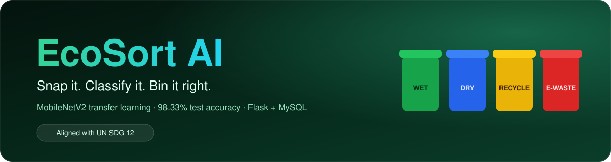
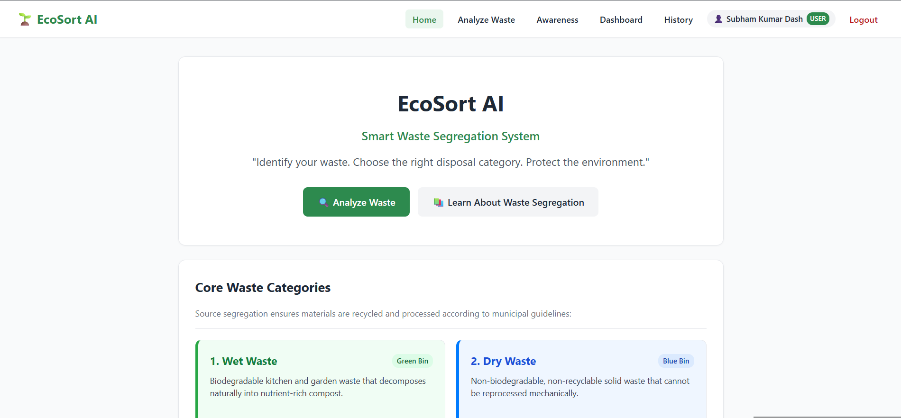
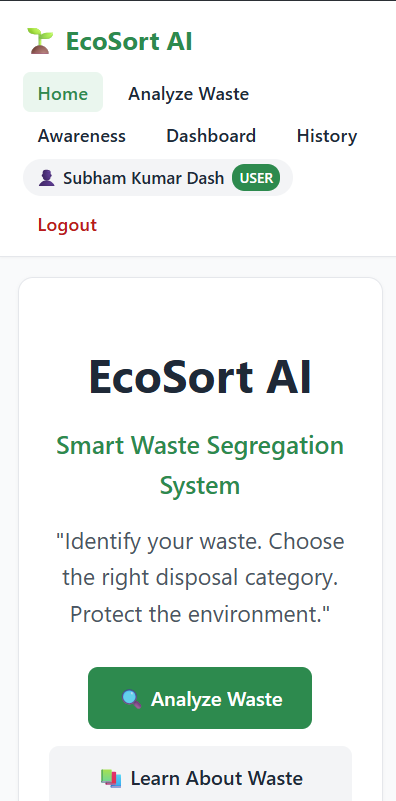
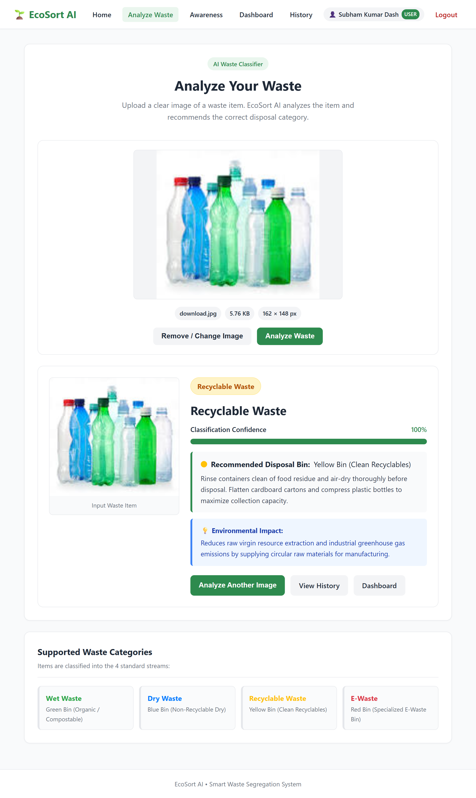
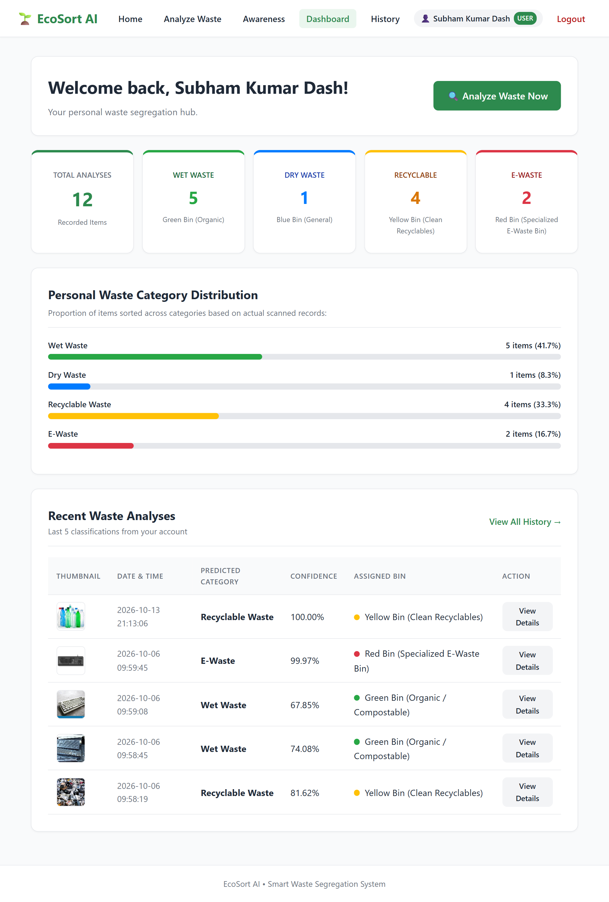
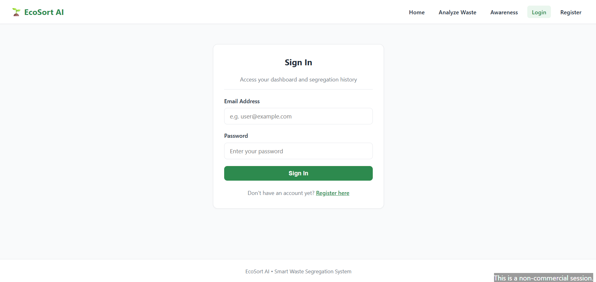
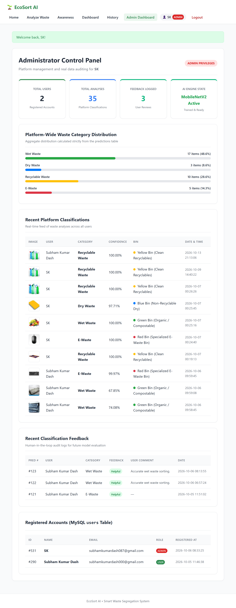
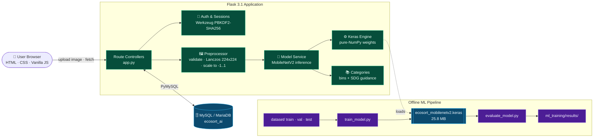
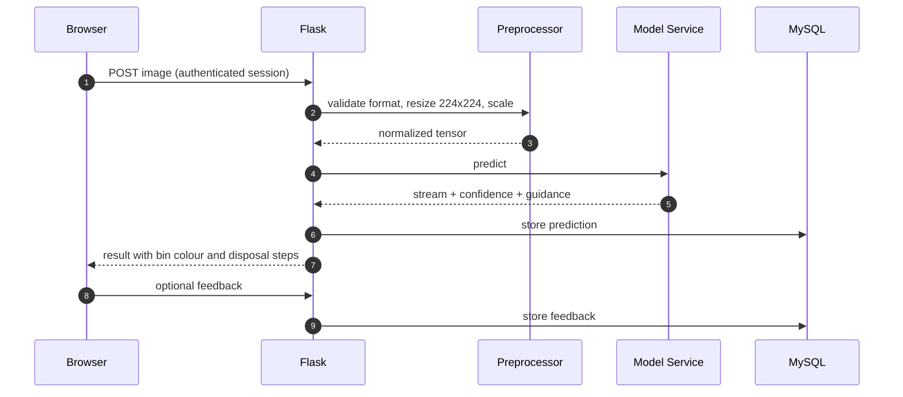

<a id="top"></a>

<div align="center">



<br/>

### Upload a photo of waste. Get the right bin, instantly.

**EcoSort AI** is an AI-powered web app that classifies waste photographs into four standard streams
and maps each one to a municipal bin colour with clear disposal guidance.<br/>
Built on **MobileNetV2 transfer learning**, aligned with **UN Sustainable Development Goal 12**.

<br/>

[](#-roadmap)
[](#-license)
[](#-testing)
[](#-model-performance)

[](https://github.com/YOUR_USERNAME/Smart-Waste-Segregation/stargazers)
[](https://github.com/YOUR_USERNAME/Smart-Waste-Segregation/network/members)
[](https://github.com/YOUR_USERNAME/Smart-Waste-Segregation/issues)
[](https://github.com/YOUR_USERNAME/Smart-Waste-Segregation/pulls)
[](https://github.com/YOUR_USERNAME/Smart-Waste-Segregation/commits)
[](https://github.com/YOUR_USERNAME/Smart-Waste-Segregation)


<br/>

<a href="#-quick-start"></a>
<a href="#-demo"></a>
<a href="#-documentation"></a>
<a href="https://github.com/YOUR_USERNAME/Smart-Waste-Segregation"></a>

</div>

<br/>


## 🧭 Navigation

<div align="center">

[Features](#-features) · [Screenshots](#-screenshots) · [Demo](#-demo) · [Architecture](#-architecture) · [Model Performance](#-model-performance) · [Tech Stack](#-tech-stack) · [Quick Start](#-quick-start) · [Structure](#-project-structure) · [Environment](#-environment-variables) · [API](#-api) · [Usage](#-usage-examples) · [Testing](#-testing) · [Deployment](#-deployment) · [Contributing](#-contributing) · [Roadmap](#-roadmap) · [FAQ](#-faq) · [License](#-license)

</div>

> [!NOTE]
> Every number in this README (accuracy, F1, test counts, latency) comes from the project's own evaluation artifacts in `ml_training/results/`. Nothing is estimated or synthetic. Items still to be measured are marked **TBD**.


## ✨ Features

<table>
<tr>
<td width="33%" valign="top">

### 🧠 Real Deep Learning
MobileNetV2 transfer learning trained on a genuine dataset and evaluated on 9,864 held-out images. No fabricated models.

</td>
<td width="33%" valign="top">

### 🗑️ Four-Stream Sorting
Wet, Dry, Recyclable and E-Waste, each mapped to a bin colour (Green, Blue, Yellow, Red).

</td>
<td width="33%" valign="top">

### 📋 Actionable Guidance
Every prediction returns safe-disposal instructions, not just a label.

</td>
</tr>
<tr>
<td valign="top">

### ⚡ Fast CPU Inference
About 165 ms per image on CPU through a lightweight pure-NumPy Keras weight execution engine. No GPU needed.

</td>
<td valign="top">

### 🔐 Secure Accounts
PBKDF2-SHA256 salted password hashing, secure sessions and role-based admin access.

</td>
<td valign="top">

### 📊 Personal Dashboard
Per-user statistics, category breakdowns and paginated prediction history.

</td>
</tr>
<tr>
<td valign="top">

### 💬 Feedback Loop
Users can rate prediction accuracy on a detailed report page, creating a signal for future retraining.

</td>
<td valign="top">

### 🛡️ Graceful Fallback
If the model artifact is unavailable, the service degrades gracefully instead of crashing.

</td>
<td valign="top">

### 🧪 61 Automated Tests
Auth, AI engine, frontend, history and ML pipeline are covered by `unittest`.

</td>
</tr>
</table>

<div align="right"><a href="#top">⬆ Back to top</a></div>


## 🗑️ Waste Streams & Bin Mapping

| Stream | Bin | Examples | Disposal guidance |
|:--|:--|:--|:--|
| **Wet Waste** | 🟢 Green | Fruit peels, cooked food, coffee grounds, garden clippings | Dispose without polythene bags into organic composters or biogas units. |
| **Dry Waste** | 🔵 Blue | Soiled wrappers, multi-layer packaging, broken ceramics | Keep dry; destined for sanitary landfill or waste-to-energy. |
| **Recyclable** | 🟡 Yellow | PET/HDPE bottles, cardboard, aluminium cans, glass bottles | Rinse clean, dry and flatten before sending to authorised recyclers. |
| **E-Waste** | 🔴 Red | Batteries, chargers, USB cables, phones, circuit boards | Never use municipal bins. Hand over to certified e-waste recyclers. |


## 📸 Screenshots

> [!TIP]
> Drop your images into `assets/screenshots/` using the file names below and they will render automatically.

<table>
<tr>
<td align="center" width="50%">
<br/>
<sub><b>Desktop</b> · Landing page with SDG 12 highlights</sub>
</td>
<td align="center" width="50%">
<br/>
<sub><b>Mobile</b> · Responsive analyzer</sub>
</td>
</tr>
<tr>
<td align="center">
<br/>
<sub><b>Analyzer</b> · Drag-and-drop classification</sub>
</td>
<td align="center">
<br/>
<sub><b>Dashboard</b> · Stats and category breakdown</sub>
</td>
</tr>
<tr>
<td align="center">
<br/>
<sub><b>Authentication</b> · Login and register</sub>
</td>
<td align="center">
<br/>
<sub><b>Admin Analytics</b> · System health and statistics</sub>
</td>
</tr>
</table>

<div align="right"><a href="#top">⬆ Back to top</a></div>


## 🎥 Demo

| Format | Where |
|:--|:--|
| **GIF walkthrough** | `` |
| **MP4 preview** | Drag `assets/demo/ecosort-demo.mp4` into a GitHub issue or PR comment, then paste the generated `user-images` URL here. |
| **YouTube** | `[](https://youtu.be/VIDEO_ID)` |
| **Live deployment** | Add your URL once deployed (see [Deployment](#-deployment)). |

<details>
<summary><b>▶ 30-second demo script (what to record)</b></summary>

1. Open the landing page and click **Analyze**.
2. Drag a photo of a plastic bottle into the upload zone.
3. Show the predicted stream, confidence and Yellow Bin guidance.
4. Open **History** and submit feedback on the prediction.
5. Show the **Dashboard** category breakdown.

</details>


## 🏗 Architecture



<details>
<summary><b>Request lifecycle</b></summary>



</details>

<div align="right"><a href="#top">⬆ Back to top</a></div>


## 📊 Model Performance

Evaluated on a held-out test split of **9,864 genuine waste images** (70 / 15 / 15 train / val / test).

<div align="center">

| 🎯 Test Accuracy | ⚖️ Macro F1 | 📏 Weighted F1 | ⏱ Latency (CPU) | 📦 Model Size |
|:-:|:-:|:-:|:-:|:-:|
| **98.33%** | **98.02%** | **98.32%** | **~165 ms** | **25.8 MB** |

</div>

9,701 of 9,864 test images were classified correctly. Validation accuracy was 97.59% (best 97.82%) with early stopping and checkpointing.

| Stream | Precision | Recall | F1 | Support |
|:--|:-:|:-:|:-:|--:|
| 🟢 Wet | 98.74% | 98.55% | **98.64%** | 4,683 |
| 🔵 Dry | 98.46% | 93.83% | **96.09%** | 956 |
| 🟡 Recyclable | 97.47% | 99.29% | **98.37%** | 3,531 |
| 🔴 E-Waste | 99.85% | 98.13% | **98.98%** | 694 |
| **Macro avg** | **98.63%** | **97.45%** | **98.02%** | **9,864** |

> [!IMPORTANT]
> **Dry Waste has the lowest recall (93.83%)**, which means some dry items are being mislabeled as other streams. It is also the smallest-but-one class, so class balancing or more dry-waste samples is the highest-value improvement (see [Roadmap](#-roadmap)).

**Training recipe:** Phase 1 trains a dense head on a frozen MobileNetV2 base. Phase 2 fine-tunes the top 30 layers at a reduced learning rate. Artifacts (`evaluation_metrics.json`, `classification_report.txt`, `confusion_matrix.png`, `training_curves.png`) live in `ml_training/results/`.

### Application performance

| Metric | Value |
|:--|:--|
| Lighthouse (Performance / Accessibility / Best Practices / SEO) | **TBD** · run `npx lighthouse http://127.0.0.1:5000 --view` |
| Page load time | **TBD** |
| Static bundle size | **TBD** (vanilla JS + one stylesheet, no framework bundle) |
| Model inference | **~165 ms** on CPU |


## 🛠 Tech Stack

<table>
<tr><td><b>Frontend</b></td><td>


</td></tr>
<tr><td><b>Backend</b></td><td>


</td></tr>
<tr><td><b>Database</b></td><td>


</td></tr>
<tr><td><b>AI / ML</b></td><td>


</td></tr>
<tr><td><b>Testing</b></td><td>

</td></tr>
<tr><td><b>DevOps / Cloud</b></td><td>


</td></tr>
<tr><td><b>Tools</b></td><td>


</td></tr>
</table>

> [!NOTE]
> No external third-party APIs are used. Inference runs fully locally.

<div align="right"><a href="#top">⬆ Back to top</a></div>


## ⚡ Quick Start

### Prerequisites

| Requirement | Version |
|:--|:--|
| Python | 3.10+ |
| XAMPP (Apache + MySQL) | Any recent release |
| Git | Any |

### 1. Clone and install

```bash
git clone https://github.com/YOUR_USERNAME/Smart-Waste-Segregation.git
cd Smart-Waste-Segregation
python -m venv venv

# macOS / Linux
source venv/bin/activate
# Windows
venv\Scripts\activate

pip install -r requirements.txt
```

### 2. Start MySQL and create the database

Open the **XAMPP Control Panel** and start **MySQL** (port `3306`), then:

```bash
mysql -u root -p < database/schema.sql
```

This creates `ecosort_ai` with four tables (`users`, `waste_categories`, `predictions`, `feedback`) and seeds the four waste categories.

### 3. Configure environment

```bash
# macOS / Linux
cp .env.example .env
# Windows
copy .env.example .env
```

### 4. (Optional) Create an admin

```bash
python create_admin.py --name "System Administrator" --email "admin@ecosort.ai" --password "ChangeMe-Strong-1!"
```

### 5. Run

```bash
python app.py
```

| Page | URL |
|:--|:--|
| Home | http://127.0.0.1:5000/ |
| Analyzer | http://127.0.0.1:5000/analyze |
| Awareness guide | http://127.0.0.1:5000/awareness |
| Health check | http://127.0.0.1:5000/api/health |

<details>
<summary><b>🐳 Docker setup (suggested, not yet shipped in the repo)</b></summary>

Add this `Dockerfile` and `docker-compose.yml` to the project root.

```dockerfile
FROM python:3.11-slim
WORKDIR /app
ENV PYTHONDONTWRITEBYTECODE=1 PYTHONUNBUFFERED=1
COPY requirements.txt .
RUN pip install --no-cache-dir -r requirements.txt gunicorn
COPY . .
EXPOSE 5000
CMD ["gunicorn", "-w", "2", "-b", "0.0.0.0:5000", "app:app"]
```

```yaml
services:
  web:
    build: .
    ports: ["5000:5000"]
    env_file: .env
    environment:
      DB_HOST: db
    depends_on: [db]
  db:
    image: mariadb:11
    environment:
      MARIADB_ROOT_PASSWORD: ${DB_PASSWORD}
      MARIADB_DATABASE: ${DB_NAME}
    volumes:
      - dbdata:/var/lib/mysql
      - ./database/schema.sql:/docker-entrypoint-initdb.d/schema.sql:ro
volumes:
  dbdata:
```

```bash
docker compose up --build
```

</details>

> [!WARNING]
> The default `SECRET_KEY` and empty `DB_PASSWORD` are for local development only. Change both before any public deployment.


## 📁 Project Structure

```text
Smart-Waste-Segregation/
├── ai_engine/                 # AI inference pipeline
│   ├── models/                # ecosort_mobilenetv2.keras + class_indices.json
│   ├── categories.py          # 4 streams, metadata, SDG guidance
│   ├── keras_engine.py        # Pure-NumPy Keras weight execution engine
│   ├── model_service.py       # Model loader, graceful fallback, prediction
│   └── preprocessor.py        # Validation, Lanczos resize 224x224, [-1, 1] scaling
├── dataset/                   # train (70%) · val (15%) · test (15%)
├── ml_training/               # Training and evaluation
│   ├── config.py              # Hyperparameters and paths
│   ├── validate_dataset.py    # Dataset audit and corruption detection
│   ├── train_model.py         # Two-phase MobileNetV2 training
│   ├── evaluate_model.py      # Test metrics and confusion matrix
│   └── results/               # Metrics JSON, report, plots
├── database/
│   ├── schema.sql             # users, waste_categories, predictions, feedback
│   └── db_connection.py       # PyMySQL factory with DictCursor
├── static/                    # css/style.css · js/main.js · uploads/
├── templates/                 # Jinja2: base, index, login, register, analyze,
│                              #   dashboard, history, prediction_detail,
│                              #   awareness, admin
├── tests/                     # 61 unit and integration tests
├── assets/                    # README banner and divider
├── AI_MODEL.md                # ML architecture and viva guide
├── app.py                     # Flask app and route controllers
├── config.py                  # Application configuration
├── create_admin.py            # Admin provisioning utility
├── requirements.txt           # Python dependencies
└── .env.example               # Environment template
```

<div align="right"><a href="#top">⬆ Back to top</a></div>


## 🔐 Environment Variables

| Variable | Required | Default | Description |
|:--|:-:|:--|:--|
| `DB_HOST` | ✅ | `localhost` | MySQL / MariaDB host |
| `DB_PORT` | ✅ | `3306` | Database port |
| `DB_USER` | ✅ | `root` | Database user |
| `DB_PASSWORD` | ✅ | *(empty)* | Database password. **Set one in production.** |
| `DB_NAME` | ✅ | `ecosort_ai` | Database name |
| `SECRET_KEY` | ✅ | dev placeholder | Flask session signing key. **Generate a new one in production.** |
| `FLASK_ENV` | ➖ | `development` | Set to `production` when deploying |

```bash
# Generate a strong secret key
python -c "import secrets; print(secrets.token_hex(32))"
```


## 📖 API

**Base URL:** `http://127.0.0.1:5000`
**Authentication:** cookie-based Flask sessions. Log in at `/login`; protected routes redirect unauthenticated users to the login page.

| Method | Endpoint | Auth | Description |
|:-:|:--|:-:|:--|
| `GET` | `/api/health` | No | Service and model health check |
| `GET` | `/` | No | Landing page |
| `GET` | `/awareness` | No | Waste segregation guide |
| `GET` | `/analyze` | Yes | Waste classifier UI (uploads are sent asynchronously via `static/js/main.js`) |

```bash
curl -s http://127.0.0.1:5000/api/health
```

> [!NOTE]
> Image upload and prediction run through the authenticated analyzer flow. Document the exact upload route and JSON response here once you freeze the public API contract.


## 🎯 Usage Examples

**Classify an image from the web UI**

1. Register or log in, then open **Analyze**.
2. Drag and drop a JPG or PNG of a waste item.
3. Read the predicted stream, its bin colour and the disposal steps.
4. Open **History** to review the report and leave feedback.

**Audit your dataset before training**

```bash
python ml_training/validate_dataset.py
```

**Retrain and re-evaluate the model**

```bash
python ml_training/train_model.py      # saves model + class_indices.json
python ml_training/evaluate_model.py   # writes metrics to ml_training/results/
```

> [!TIP]
> If the dataset folders are empty, training halts with a pre-flight notice. It never produces a synthetic model.

<div align="right"><a href="#top">⬆ Back to top</a></div>


## 🧪 Testing

```bash
# Full suite (61 tests)
python -m unittest discover tests

# Single module
python -m unittest tests.test_auth
python -m unittest tests.test_ai_engine
python -m unittest tests.test_frontend
python -m unittest tests.test_history_feedback
python -m unittest tests.test_ml_pipeline
```

| Module | Covers |
|:--|:--|
| `test_auth.py` | Authentication, hashing, access control |
| `test_ai_engine.py` | Preprocessing, normalization, model inference |
| `test_frontend.py` | Public routes, awareness page, templates |
| `test_history_feedback.py` | Dashboards, history ownership, feedback |
| `test_ml_pipeline.py` | Dataset validation, metric math, pre-flight guards |

<details>
<summary><b>Coverage, linting and formatting (optional tooling)</b></summary>

```bash
pip install coverage ruff black

coverage run -m unittest discover tests
coverage report -m
coverage html            # open htmlcov/index.html

ruff check .
black .
```

</details>


## 🚀 Deployment

> [!IMPORTANT]
> EcoSort AI is a stateful Flask + MySQL app that loads a 25.8 MB TensorFlow model. **Vercel and Netlify are serverless/static hosts and are not a good fit for the full app.** They can host a marketing page or demo front end only. Use Docker-based hosting for the real thing.

| Platform | Fit | Notes |
|:--|:-:|:--|
| 🐳 **Docker** | ✅ Best | Use the Dockerfile above with gunicorn. |
| 🚂 **Railway** | ✅ Great | Deploy from GitHub, add a MySQL plugin, set the env vars from the table above. |
| 🌊 **DigitalOcean** | ✅ Great | App Platform (Dockerfile) plus Managed MySQL, or a Droplet running `docker compose`. |
| ☁️ **AWS** | ✅ Great | ECS/Fargate or Elastic Beanstalk with RDS MySQL; store uploads in S3 for scale. |
| ▲ **Vercel** | ⚠️ Limited | Not suitable for the Flask app and local model. Static showcase only. |
| 🟩 **Netlify** | ⚠️ Limited | Static showcase only. |

<details>
<summary><b>Production checklist</b></summary>

- [ ] Strong, unique `SECRET_KEY`
- [ ] Non-root DB user with a password
- [ ] `FLASK_ENV=production`, served by gunicorn behind HTTPS
- [ ] Persistent volume or object storage for `static/uploads/`
- [ ] Change the sample admin password from the README
- [ ] Regular database backups

</details>

<div align="right"><a href="#top">⬆ Back to top</a></div>


## 🤝 Contributing

Contributions are welcome.

1. **Fork** the repo and create a branch from `main`.
2. **Name branches** `feat/…`, `fix/…`, `assets/…`, `test/…` or `refactor/…`.
3. **Write commits** in [Conventional Commits](https://www.conventionalcommits.org/) style, e.g. `feat(ai_engine): add confidence threshold`.
4. **Run the tests** with `python -m unittest discover tests` and make sure all pass.
5. **Open a pull request** describing the change, the motivation and how you tested it.

Please keep the project's integrity rule: no fabricated datasets, models or metrics.


## 🗺 Roadmap

- [x] Real MobileNetV2 transfer-learning model (98.33% test accuracy)
- [x] Four-stream classification with bin colour mapping
- [x] Authentication with PBKDF2-SHA256 and admin role
- [x] User dashboard, history and feedback
- [x] Admin statistics and health monitoring
- [x] 61 automated tests
- [ ] Improve Dry Waste recall (class balancing, more samples)
- [ ] Multi-item detection in a single photo
- [ ] Use stored feedback for periodic retraining
- [ ] Dockerfile and CI pipeline (tests on every PR)
- [ ] Public REST API with token authentication
- [ ] Live camera capture on mobile
- [ ] Multilingual disposal guidance


## ❓ FAQ

<details>
<summary><b>Is the 98.33% accuracy real?</b></summary>

Yes. It is measured on 9,864 held-out test images that were never used for training or validation. See `ml_training/results/` for the raw artifacts.

</details>

<details>
<summary><b>Do I need a GPU?</b></summary>

No. Inference runs on CPU in roughly 165 ms per image. Training is faster with a GPU but not required.

</details>

<details>
<summary><b>Why four categories instead of more?</b></summary>

They match the standard source-segregation streams used with municipal bin colours, which keeps the guidance simple and actionable for households.

</details>

<details>
<summary><b>What happens if the model file is missing?</b></summary>

The model service falls back gracefully rather than crashing. Retrain with `ml_training/train_model.py` or restore `ai_engine/models/ecosort_mobilenetv2.keras`.

</details>

<details>
<summary><b>Where is the technical deep dive?</b></summary>

See [`AI_MODEL.md`](AI_MODEL.md) for transfer learning, depthwise separable convolutions, inverted residuals, hyperparameters, loss formulation and edge cases, and [`ml_training/README.md`](ml_training/README.md) for the training workflow.

</details>


## 📚 Documentation

| Resource | Description |
|:--|:--|
| [`AI_MODEL.md`](AI_MODEL.md) | 14-point ML architecture and viva guide |
| [`ml_training/README.md`](ml_training/README.md) | Dataset preparation and training |
| `/awareness` page | Educational guide for end users |

## 🙌 Acknowledgements

- [MobileNetV2](https://arxiv.org/abs/1801.04381) by Sandler et al., and the ImageNet pretrained weights
- [TensorFlow / Keras](https://www.tensorflow.org/), [Flask](https://flask.palletsprojects.com/), [scikit-learn](https://scikit-learn.org/)
- [Shields.io](https://shields.io/) for badges and [Mermaid](https://mermaid.js.org/) for diagrams
- [AICTE](https://www.aicte-india.org/) B.Tech CSE academic framework
- [UN SDG 12: Responsible Consumption and Production](https://sdgs.un.org/goals/goal12)

## 👤 Author

Built by **YOUR NAME** · [GitHub](https://github.com/YOUR_USERNAME) · [LinkedIn](https://www.linkedin.com/in/YOUR_HANDLE)

## 📜 License

Developed as an academic B.Tech Computer Science and Engineering project following AICTE guidelines and UN SDG 12 standards. Add a `LICENSE` file (for example MIT) if you want to permit reuse, and update the License badge to match.

## ❤️ Support

<div align="center">

If EcoSort AI helped you, a ⭐ makes a real difference.

[](https://github.com/YOUR_USERNAME/Smart-Waste-Segregation)
[](https://github.com/sponsors/YOUR_USERNAME)
[](https://www.buymeacoffee.com/YOUR_HANDLE)
[](mailto:you@example.com)

<br/>

**Sort smarter. Waste less. 🌍**

<a href="#top">⬆ Back to top</a>

</div>
